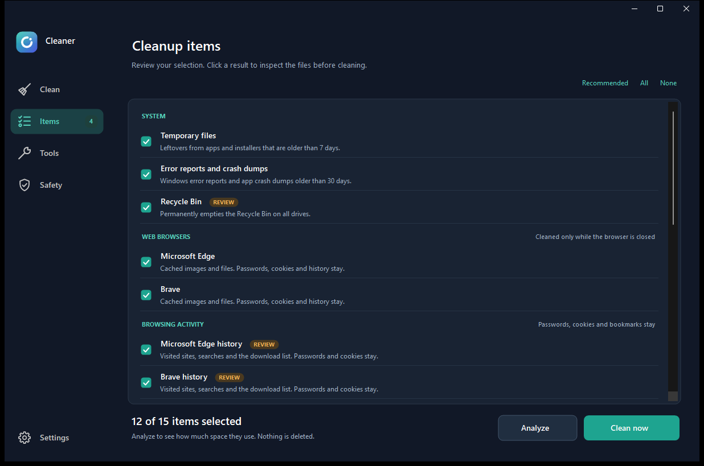

<div align="center">

<h1>Cleaner</h1>
<p><strong>See what goes. Keep what matters.</strong></p>
<p>A Windows desktop cleaner with a preview-first workflow, a polished interface, and explicit control over browsing activity.</p>
<p><a href="https://github.com/LeerBox/Cleaner/releases">Download for Windows</a> · <a href="#quick-start">Quick start</a> · <a href="docs/SAFETY.md">Safety & limitations</a> · <a href="https://github.com/LeerBox/Cleaner/issues">Report an issue</a></p>
</div>



*Cleanup review screen. Available categories depend on the applications installed.*

## A clearer way to clean

**Analyze → Review → Confirm.** Inspect candidates before committing to permanent deletion. Cleaner uses specific cleanup locations instead of searching your entire drive for files to remove.

- **Browser caches:** supported Chromium browsers and Firefox cache locations, with running-app checks.
- **Optional browsing activity:** separate, opt-in history cleanup for supported Chromium browsers. Password and cookie files are excluded from these rules.
- **Windows cleanup:** aged temporary files, diagnostic reports, and optional administrator-only locations.
- **Explorer privacy:** recent-folder and Jump List cleanup with pin checks.
- **Your workspace:** light, dark and system themes; custom vector icons; a responsive interface.
- **Reviewable behavior:** readable PowerShell source, sandbox tests, and local operation logs.

## Quick start

1. Download **Cleaner-Portable.zip** from [Releases](https://github.com/LeerBox/Cleaner/releases).
2. Extract the entire archive to a folder you control.
3. Open **Cleaner.exe**. Keep its companion scripts and Assets folder together.
4. Click **Analyze**, review the Items page, then confirm your selection.

Close applications before cleaning their caches. The optional Close app action requests a normal close first; forced closing requires a separate confirmation and may lose unsaved work.

**Requirements:** 64-bit Windows 10/11 and Windows PowerShell 5.1. The EXE is a compiled launcher for the PowerShell application, not a standalone rewrite. Administrator rights are optional and requested through Settings or `Cleaner.exe /admin`.

## Before you clean

Deletion is permanent. File age or a cache location cannot prove that a file is unimportant. Review candidates and back up valuable work. History cleanup is optional; browser sync may restore activity. Cleaner does not erase activity held by websites or online accounts.

This early public release is **unsigned** and has not undergone an independent security audit. Windows may show a reputation warning. Source and build instructions are provided so you can inspect the application.

## Build from source

Run from the repository root in Windows PowerShell:

```powershell
powershell.exe -NoProfile -ExecutionPolicy Bypass -File .\Build\Build.ps1
```

The build uses the Windows .NET Framework C# compiler and creates `dist\Cleaner\Cleaner.exe` with companion files. No external NuGet packages are required. The execution-policy argument applies only to that process.

## Verification

```powershell
powershell.exe -NoProfile -STA -ExecutionPolicy Bypass -File .\Tests\Test-CleanerEngine.ps1
```

The suite exercises deletion in disposable test folders, including locked files, links, protected files and history-file allowlists. It also reads real cleanup locations without cleaning them. Passing these checks does not establish compatibility with every browser version or Windows configuration.

## Contributing

See [CONTRIBUTING.md](CONTRIBUTING.md). Please include Windows and browser versions when reporting issues, and remove personal paths from logs and screenshots. Suggestions for accessibility, translations and better diagnostics are welcome.

No open-source license has been granted yet. Public source availability does not grant redistribution or modification rights beyond those provided by GitHub's terms and applicable law.