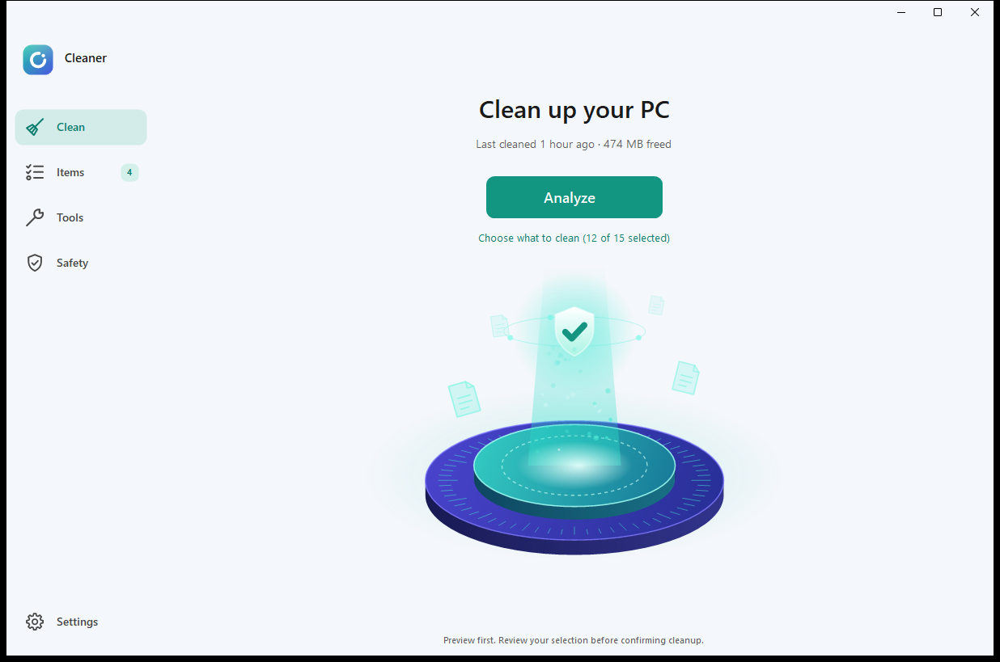
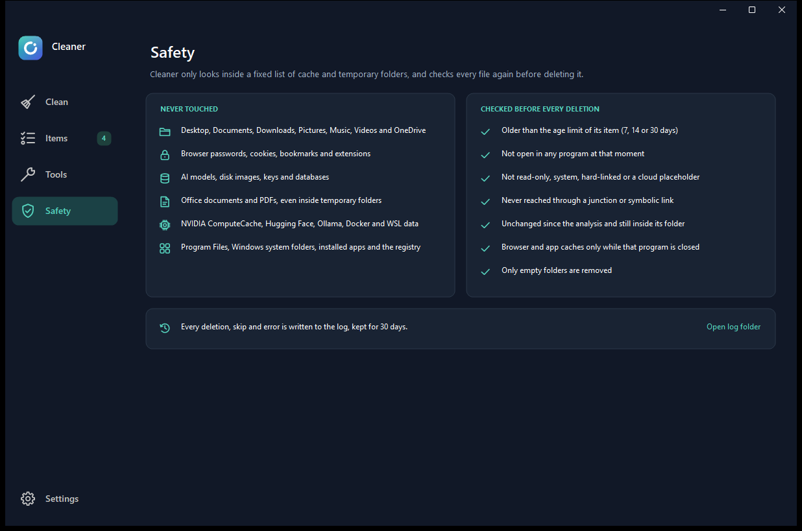
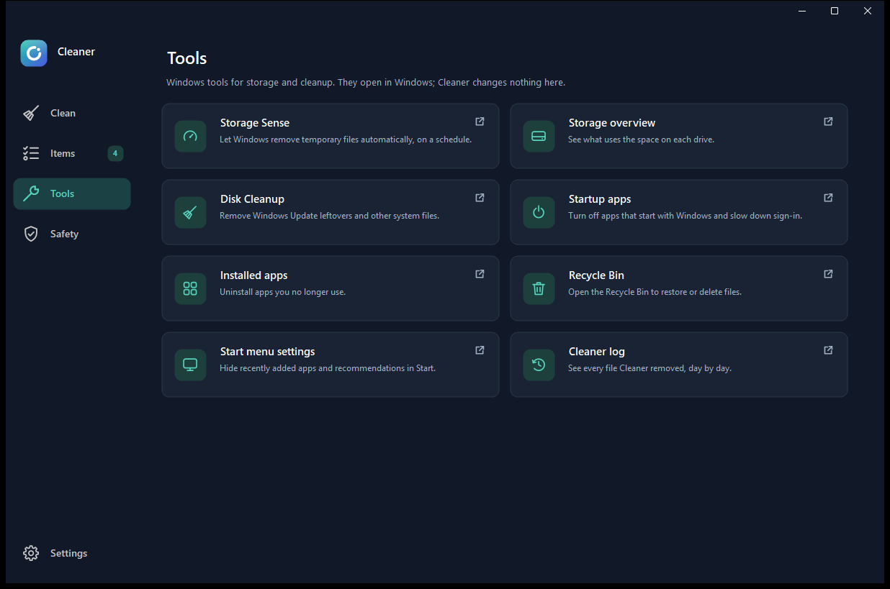
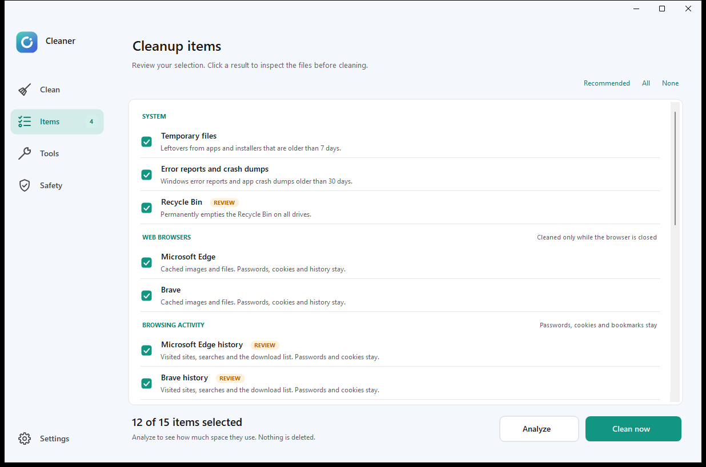

<div align="center">


# Cleaner

### See what goes. Keep what matters.

Free up space on Windows without guessing what gets deleted.<br>
Cleaner shows you every item first — you decide, then it cleans.

<a href="https://github.com/LeerBox/Cleaner/releases"></a>

[](https://github.com/LeerBox/Cleaner/releases)
[](LICENSE)


**Free · Open source · Portable · No ads · No telemetry**

<picture>
  <source media="(prefers-color-scheme: dark)" srcset="docs/images/home-dark.png">
  
</picture>

</div>

## Why people pick Cleaner

| | |
| --- | --- |
| 👀 **Preview first** | Analyze shows what each category would remove and how much space it frees. Nothing is deleted until you confirm. |
| 🎯 **Only known locations** | Cleaner looks inside a fixed list of cache and temporary folders. It never scans your whole drive for things to remove. |
| 🔒 **Your data stays** | Desktop, Documents, Downloads, Pictures and OneDrive are never touched. Neither are browser passwords, cookies, bookmarks or extensions. |
| 🕶️ **Privacy on your terms** | Browsing-history cleanup is a separate, opt-in category that is never preselected. |
| 📦 **Nothing to install** | Extract the zip and run it. No installer, no account, no background service. |
| 📖 **Nothing hidden** | Readable PowerShell source with no network calls, sandbox tests, and a local log of every deletion. |

## Get started in a minute

1. **[Download Cleaner-Portable.zip](https://github.com/LeerBox/Cleaner/releases)** from the latest release.
2. **Extract** the whole archive to a folder you control.
3. **Run `Cleaner.exe`** and click **Analyze**.
4. **Review** the Items page, then confirm your selection.

**Requirements:** 64-bit Windows 10 or 11 with Windows PowerShell 5.1 (included with Windows).

> [!WARNING]
> Cleaner is an **unsigned public preview** without an independent security audit, so Windows may show a reputation warning. Cleanup **permanently deletes** the items you select — review them and back up valuable work first.

## Take a look

| Review before cleaning | Built-in safety rules |
| :---: | :---: |
|  |  |
| **Shortcuts to Windows tools** | **Light theme** |
|  |  |

Light, dark and system themes are included. Categories shown depend on the applications installed.

## What it cleans

| Group | Categories | Notes |
| --- | --- | --- |
| **System** | Temporary files · Error reports and crash dumps · Recycle Bin | Temporary files older than 7 days; reports and dumps older than 30 days |
| **Web browsers** | Chrome · Edge · Brave · Vivaldi · Opera · Opera GX · Firefox | Cache only. Passwords, cookies and history stay |
| **Browsing activity** | History for the Chromium browsers above | Opt-in, never preselected. Firefox history is not cleared |
| **Apps** | Discord · Slack · Visual Studio Code · Cursor | Cached web content. Settings, extensions and sign-in are kept |
| **Explorer privacy** | Recent files list · Recent folders · Jump Lists | Pins are checked; a safety copy of the list is saved locally |
| **Developer** | pip · npm · NuGet HTTP cache | Downloads older than 30 days |
| **Graphics** | DirectX and GPU driver shader caches | Older than 30 days |
| **Administrator** | Windows temporary files · System error reports and dumps | Requires administrator rights |

Administrator rights are optional. Request them from Settings or start `Cleaner.exe /admin` to unlock the last group.

## Safety

Every file is checked again right before deletion: it must be older than its category's age limit, not open in any program, unchanged since the analysis, and not reached through a link or junction.

Even so, please keep these in mind:

- **Deletion is permanent.** File age or a cache location cannot prove that a file is unimportant.
- **History cleanup is local.** Browser sync may restore activity, and Cleaner does not erase activity held by websites or online accounts. It is not secure erasure.
- **Close applications first.** The optional *Close app* action requests a normal close; forced closing needs a separate confirmation and may lose unsaved work.
- **Compatibility varies.** Browser storage formats change between versions, and running-app checks reduce risk without eliminating it.

Full details are in [Safety and limitations](docs/SAFETY.md).

## FAQ

**Why does Windows warn me when I run it?**
The preview release is not code-signed yet, so Windows SmartScreen has no reputation data for it. You can verify the download against `SHA256SUMS.txt` in the release, read the source, or build it yourself.

**Is `Cleaner.exe` the whole program?**
No. It is a small compiled launcher for the PowerShell application, so keep the companion scripts and the `Assets` folder next to it. The source you can read is the code that runs.

**Can I undo a cleanup?**
No. That is why Cleaner shows every candidate first and leaves the riskier categories unselected by default.

## For developers

<details>
<summary><strong>Build from source</strong></summary>

Run from the repository root in Windows PowerShell:

```powershell
powershell.exe -NoProfile -ExecutionPolicy Bypass -File .\Build\Build.ps1
```

The build uses the Windows .NET Framework C# compiler and creates `dist\Cleaner\Cleaner.exe` with its companion files. No external NuGet packages are required. The execution-policy argument applies only to that process.

</details>

<details>
<summary><strong>Run the tests</strong></summary>

```powershell
powershell.exe -NoProfile -STA -ExecutionPolicy Bypass -File .\Tests\Test-CleanerEngine.ps1
```

The suite exercises deletion in disposable test folders, including locked files, links, protected files and history-file allowlists. It also reads real cleanup locations without cleaning them. Passing these checks does not establish compatibility with every browser version or Windows configuration.

</details>

## Feedback and contributing

Found a bug or have an idea? [Open an issue](https://github.com/LeerBox/Cleaner/issues) with your Windows and browser versions, and remove personal paths from logs and screenshots. Suggestions for accessibility, translations and better diagnostics are welcome. See [CONTRIBUTING.md](CONTRIBUTING.md) before sending a pull request.

If Cleaner is useful to you, a ⭐ helps other people find it.

## License

Released under the [MIT License](LICENSE).
